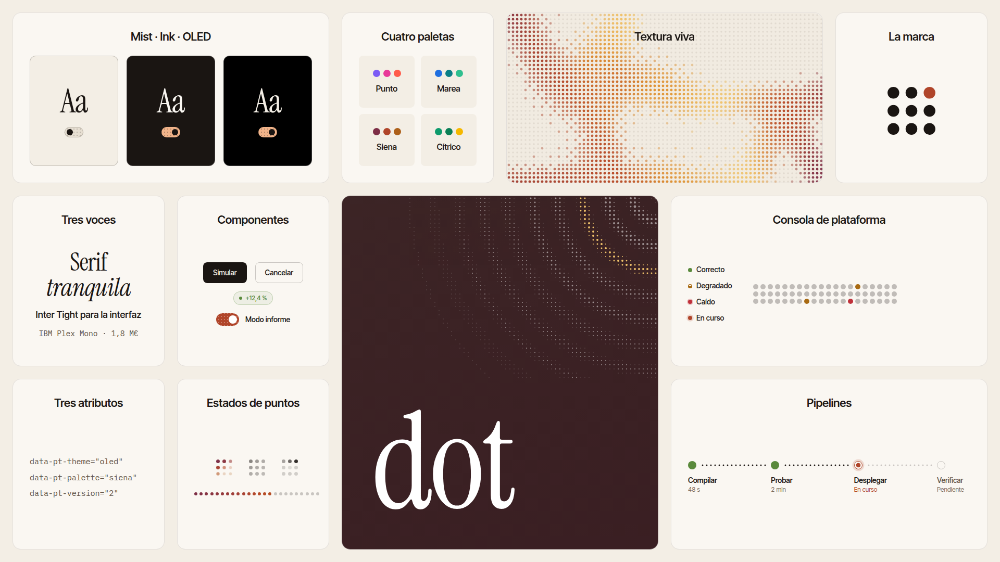

# Dot

<picture>
  <source media="(prefers-color-scheme: dark)" srcset="docs/overview-dark.png">
  
</picture>

Propuesta de lenguaje de diseño inspirada en el póster de _Otherwise_: superficies de puntos
por las que pasan cintas de color, paneles de vidrio esmerilado encima y una serif tranquila
para los titulares. Todo se documenta y se prueba en un Storybook.

- **Tokens** en CSS (`--pt-*`): color (mist, ink y acentos), gradientes, tipografía, espacio,
  radios y movimiento, con tema claro (_Mist_) y oscuro (_Ink_).
- **Familia de puntos**: `DotField` (la textura animada, en canvas), `DotPattern` (patrones
  compuestos y quietos, en SVG), `DotLoader`, `DotProgress` y `DotBars`.
- **Dot 2** (`data-pt-version="2"`): la edición formal. Siena de serie, un solo acento
  sólido, papel con filete en vez de vidrio, radios en la rejilla y patrones anclados en
  lugar de cintas. Ver [Dot 2](#dot-2).
- **Paletas**: `punto` (la original), `marea`, `siena` y `citrico`, intercambiables con
  `data-pt-palette` en el mismo elemento que `data-pt-theme`.
- **Componentes**: `Button`, `Badge`, `GlassCard`, `TextField`, `Segmented`, `Sparkle`,
  `Petals`, `DotMark`.
- **Transversales**: `Stack`, `SectionHeader`, `Stat`, `Callout`, `Switch`, `Avatar` /
  `AvatarGroup` y `DotDivider`.
- **Páginas**: el póster original reconstruido con el sistema, una pantalla de producto
  interactiva (pulsa «Simular») y un panel de equipo (`Workspace`).

La propuesta completa (principios, paletas y cuándo usar cada una) está en la página
**Dot › Introducción** del Storybook.

> Antes se llamaba **Punto**. El nombre cambia; la API no: los tokens, las clases y los
> atributos siguen con el prefijo `pt-` (`--pt-*`, `.pt-folio`, `data-pt-theme`), y la paleta
> original sigue siendo `punto`.

## Desarrollo

Requiere [devenv](https://devenv.sh) (Nix). Todo lo demás (Node 24, pnpm, Biome) lo trae el
entorno.

```bash
devenv shell -- dev       # Storybook en modo desarrollo
devenv shell -- lint      # tsc + biome + comprobación del pin de biome
devenv shell -- build     # Storybook estático en storybook-static/
devenv shell -- preview   # sirve storybook-static/
```

| URL                        | Qué                                   |
| -------------------------- | ------------------------------------- |
| `http://pi-home:36006`     | Storybook (`dev` o `devenv up`)       |
| `http://pi-home:36007`     | Build estático (`preview`)            |

Perfiles: `devenv --profile ide shell` activa el LSP de TypeScript.

La imagen de arriba es la story **Dot › Resumen**, capturada a 1920 × 1080 con el
Storybook estático en marcha (`preview`):

```bash
for t in light dark; do
  nix shell nixpkgs#chromium -c chromium --headless --hide-scrollbars \
    --window-size=1920,1080 --virtual-time-budget=6000 --screenshot="docs/overview-$t.png" \
    "http://localhost:36007/iframe.html?id=dot-resumen--resumen&viewMode=story&globals=theme:$t;palette:siena"
done
```

## Paletas

```html
<html data-pt-theme="dark" data-pt-palette="marea">
```

Los componentes leen roles y el espectro (`--pt-spectrum-1…6`, `--pt-spectrum-accent`,
`--pt-spectrum-soft`), nunca un tono con nombre; cada paleta reasigna neutros y espectro.
`PALETTES` y `heroDotPalette()` (exportados) dan la lista y la textura de `DotField` que
corresponde a cada una.

## Dot 2

```html
<html data-pt-theme="light" data-pt-version="2">
```

`src/tokens/v2.css` solo reajusta tokens y recetas (radios, vidrio → papel, degradado →
sello, `bloom` → lámina de tinta), así que todos los componentes lo siguen sin reglas
propias. Sin `data-pt-palette`, un ámbito v2 usa Siena. La pieza nueva es `DotPattern`:

```tsx
<GlassCard backdrop={<DotPattern motif="rings" anchor="top-right" cols={22} rows={14} highlight={2} />}>
  …
</GlassCard>
```

| Prop        | Valores                                                           |
| ----------- | ----------------------------------------------------------------- |
| `motif`     | `grid` · `fade` · `rings` · `orb` · `wave` · `diagonal`           |
| `cols`, `rows` | tamaño en puntos; sin ellos rellena el contenedor posicionado  |
| `anchor`    | esquina, borde o centro al que se fija (`origin` cambia desde dónde crece el motivo) |
| `highlight` | banda (anillo, cresta, diagonal…) que lleva el acento             |
| `tone`, `intensity`, `period`, `falloff`, `motion` | tinta, opacidad, separación, caída y respiración |

Es geometría determinista sobre la rejilla, lee los roles del tema (sirve en cualquier
paleta, en Mist y en Ink) y pinta como mucho diez `<path>` por patrón. La propuesta completa
está en **Dot › Versión 2**; las páginas, en **Pages › Dot 2**.

## DevOps

Componentes para consolas y paneles de operación (grupo **DevOps** del Storybook; juntos en
**Pages › Dot 2 › Operaciones**):

| Componente | Para qué |
| ---------- | -------- |
| `Status` | estado como punto + palabra (`ok` · `warn` · `error` · `running` · `idle`) |
| `DataTable` | tabla pautada con orden por columna, cifras en mono, densidad y fila seleccionada |
| `Diagram` | nodos en una rejilla (`service` · `store` · `queue` · `external`) unidos por conectores de puntos |
| `Pipeline` | etapas de una ejecución, horizontal o vertical |
| `KeyValue` | metadatos con guía de puntos, o apilados en columnas |
| `CodeBlock` | código o configuración, con números, líneas marcadas y copiar |
| `LogView` | líneas de registro con hora, nivel y origen (`role="log"`) |
| `DotUptime` | historial por periodos como tira de puntos |

Usan `--pt-font-mono` (IBM Plex Mono) y un rol nuevo, `--pt-warning`.

## Temas y modo noche

`data-pt-theme` admite `light` (Mist), `dark` (Ink) y `oled` (Ink sobre negro puro).

```tsx
import { ThemeSwitch, themeInitScript, useTheme } from "desing";

const { preference, theme, setPreference } = useTheme({ night: "oled" });
<ThemeSwitch value={preference} onChange={setPreference} />;
```

- `useTheme()` guarda la preferencia (`system` · `light` · `dark` · `oled`) en `localStorage`,
  sigue a `prefers-color-scheme` mientras sea `system` (`night` decide si eso es `dark` u
  `oled`) y pone `data-pt-theme` en `<html>` (o en `target`; con `target: null` no toca nada).
- `themeInitScript()` devuelve el script en línea para el `<head>` que aplica el tema antes
  del primer pintado.
- `ThemeSwitch` es controlado; `variant="icons"` para barras, `options` para acortar la lista.

## DotField

```tsx
<DotField palette="aurora" motion="flow" gap={8} pixel={3} seed={11} style={{ height: 480 }}>
  <GlassCard tone="bloom">…</GlassCard>
</DotField>
```

| Prop        | Valores                                                           |
| ----------- | ----------------------------------------------------------------- |
| `palette`   | `aurora` · `ember` · `dusk` · `graphite` · `night` · `paper` · `marea` · `siena` · `citrico` (o una propia) |
| `motion`    | `flow` (se desplaza) · `breathe` (pulsa en su sitio) · `still`    |
| `gap`       | distancia entre puntos en px                                      |
| `dotSize`   | diámetro como fracción de `gap`                                   |
| `pixel`     | agrupa puntos en bloques de N×N del mismo color (aspecto bitmap)  |
| `speed`, `intensity`, `seed`, `fps` | ritmo, opacidad, composición y tope de fotogramas |
| `surface`   | `palette` pinta el fondo de la paleta · `theme` deja el canvas transparente sobre el papel del tema (`--pt-bg`) |

Regla para las paletas sobrias: `graphite` sobre Mist y `night` sobre Ink.

El campo se calcula con un píxel por punto y el canvas lo escala y lo recorta con un patrón
de círculos: tres operaciones de dibujo por fotograma, sea cual sea el tamaño. Se pausa fuera
de pantalla o con la pestaña oculta, y con `prefers-reduced-motion` dibuja un único fotograma.

## Estructura

```
src/
  tokens/tokens.css        tokens y temas
  components/<Nombre>/     componente + CSS + stories
  stories/                 introducción (MDX), foundations y páginas
.storybook/                configuración, tema del manager y selector de tema
```
